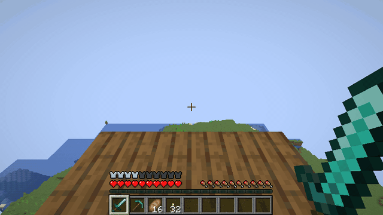
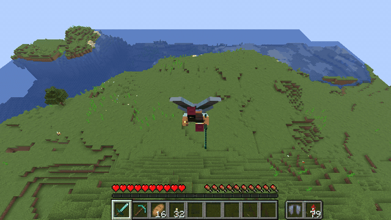
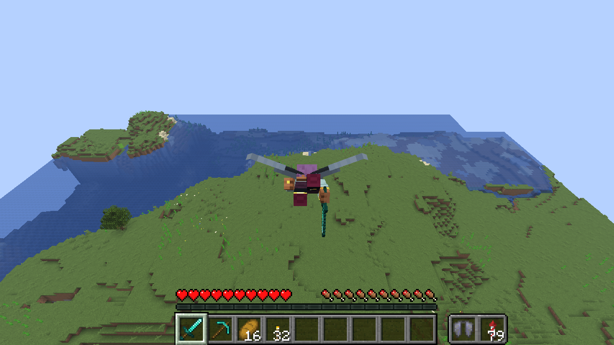
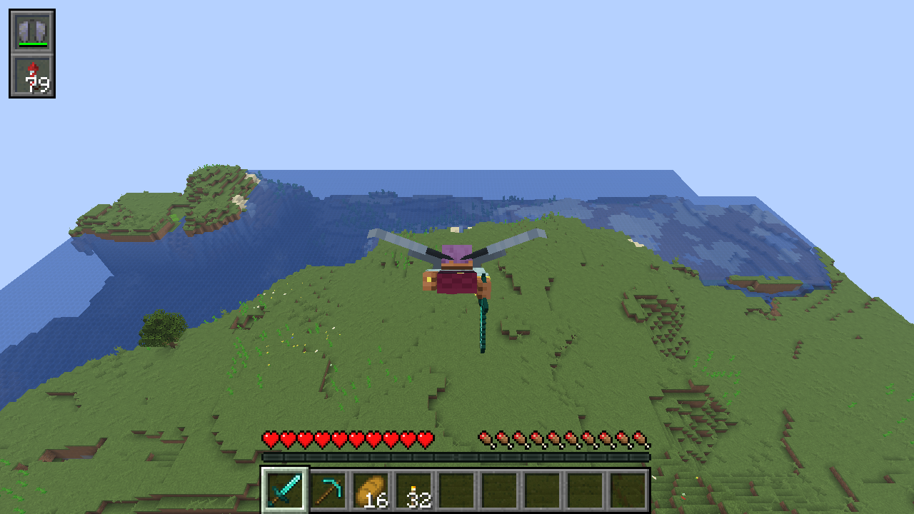
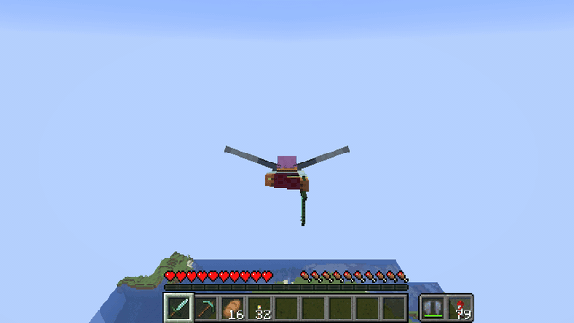
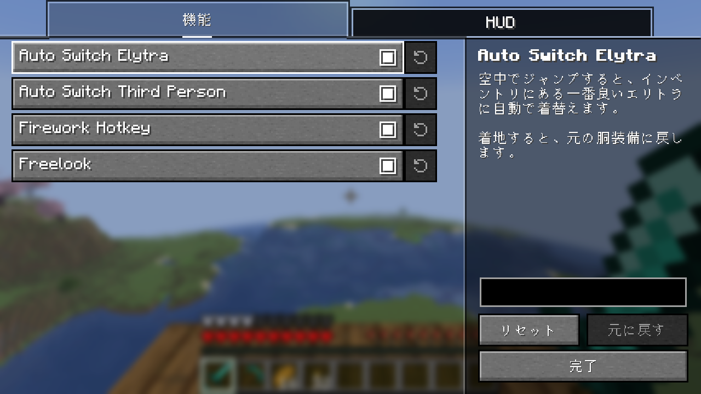

# Elytra Plus

[English](README.md) | 日本語

エリトラでの飛行を快適にする Fabric 向けクライアント MOD です。
クライアントに入れるだけで動作し、バニラサーバーでも使えます（サーバー側への導入は不要です）。

## 機能

### Auto Switch Elytra・Auto Switch Third Person

空中でジャンプすると、インベントリにある一番良いエリトラに着替え、三人称視点（背面）に切り替えます。
着地すると、元の胴装備に戻し、一人称視点に戻します。

### Firework Hotkey・HUD

飛んでいる間、キーを押すと花火を使います。花火は手に持っていなくても、インベントリのどこにあっても使えます。キーは操作設定の「Elytra Plus」で割り当ててください。
ホットバーの横に、耐久値の分かるエリトラのスロットと、次に使う花火と合計数（シュルカーボックスやバンドルの中も含む）の分かる花火のスロットを表示します。
スロットの場所は設定で変えられます（ホットバーの横か画面の隅、左右、横並びか縦並び、X・Y の細かいずらし）。見た目もホットバー風とインベントリ風から選べます。

### Freelook

飛んでいる間、キーを押している間はカメラだけが回り、飛ぶ方向を変えずに周りを見渡せます。
キーは操作設定の「Elytra Plus」で割り当ててください（Freelook Plus を入れている場合は「Freelook Plus」で割り当てます）。

## 設定

各機能の ON/OFF は設定画面で切り替えられます。設定画面は [Mod Menu](https://modrinth.com/mod/modmenu) から開きます。
キーは初期状態では割り当てられていません。操作設定の「Elytra Plus」で割り当ててください。

## 必要なもの

- [Fabric API](https://modrinth.com/mod/fabric-api)
- [YetAnotherConfigLib](https://modrinth.com/mod/yacl)
- [Mod Menu](https://modrinth.com/mod/modmenu)（任意。設定画面を開くのに使います）

対応する Minecraft のバージョンは各リリースに記載しています。

## 注意

Auto Switch Elytra と Firework Hotkey は、通常のインベントリ操作と同じ方法でアイテムを入れ替えます。
バニラサーバーでは問題なく動作しますが、アンチチートを導入しているサーバーでは不正な操作と判定される可能性があります。
また、サーバーによってはルールで Freelook が禁止されていることもあります。
使用はサーバーのルールに従ってください。
