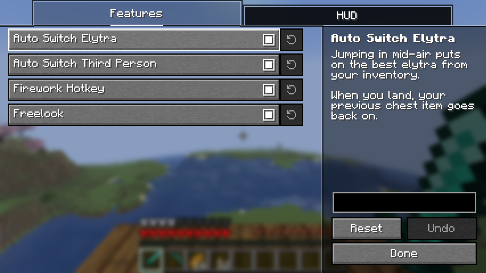

# Elytra Plus

English | [日本語](README.ja.md)

A client-side Fabric mod that makes flying with an elytra more comfortable.
Just install it on your client; it also works on vanilla servers (nothing needs to be installed on the server).

## Features

### Auto Switch Elytra and Auto Switch Third Person

Jumping in mid-air puts on the best elytra from your inventory, and the view switches to the rear third-person view.
When you land, your previous chest item goes back on and the view returns to first person.

### Firework Hotkey and HUD

While flying, press the key to use a firework rocket from anywhere in your inventory; it doesn't need to be in your hand. Assign the key under Controls → Elytra Plus.
Next to the hotbar, the elytra slot shows its durability, and the firework slot shows the rocket used next and how many you have, including those in shulker boxes and bundles.
The slots can be moved in the settings: next to the hotbar or to a corner of the screen, on either side, lined up horizontally or vertically, with fine X/Y offsets. They can look like the hotbar or like inventory slots.

### Freelook

While flying, hold the key to turn only the camera and look around without changing the direction you fly.
Assign the key under Controls → Elytra Plus (with Freelook Plus installed, under Controls → Freelook Plus).

## Settings

Each feature can be turned on or off in the settings screen, opened from [Mod Menu](https://modrinth.com/mod/modmenu).
The keys are unbound by default; assign them under Controls → Elytra Plus.

## Requirements

- [Fabric API](https://modrinth.com/mod/fabric-api)
- [YetAnotherConfigLib](https://modrinth.com/mod/yacl)
- [Mod Menu](https://modrinth.com/mod/modmenu) (optional, for opening the settings screen)

The supported Minecraft versions are listed on each release.

## Note

Auto Switch Elytra and Firework Hotkey move items the same way normal inventory clicks do.
They work fine on vanilla servers, but servers with an anti-cheat may flag them as illegitimate actions.
Some servers also prohibit freelook in their rules.
Follow the rules of the server you play on.
